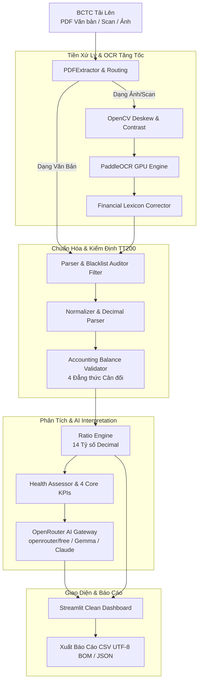

# Financial Health System 📊🇻🇳
### Hệ Thống Trích Xuất BCTC & Đánh Giá Sức Khỏe Doanh Nghiệp (TT200/2014/TT-BTC)

[](https://www.python.org/)
[](app.py)
[](src/ocr/)
[](https://openrouter.ai/)
[](src/financial/ratios.py)
[-brightgreen.svg)](tests/unit/)
[](https://thuvienphapluat.vn/)

**Financial Health System** là giải pháp phần mềm chuyên sâu tự động hóa quy trình phân tích Báo cáo tài chính (BCTC Hợp nhất và BCTC Riêng theo **Thông tư 200/2014/TT-BTC**). Hệ thống tiếp nhận tài liệu số hóa đa định dạng (PDF văn bản, PDF scan dạng ảnh hoặc ảnh chụp BCTC), tự động bóc tách số liệu qua mô hình thị giác máy học kết hợp OCR tăng tốc GPU, chuẩn hóa cấu trúc kế toán, kiểm định 4 đẳng thức cân đối kế toán, tính toán 14 tỷ số tài chính với số học `Decimal` tuyệt đối, và cung cấp nhận định điều hành chuyên sâu bằng Trí tuệ nhân tạo (AI Financial Interpreter) thông qua OpenRouter API.

> 🔒 **Quyền riêng tư & Zero File Retention**: Xử lý hoàn toàn trong bộ nhớ RAM (In-Memory Processing). Tuyệt đối không lưu trữ tệp người dùng tải lên ra ổ đĩa và giải phóng bộ nhớ ngay sau khi kết thúc phiên phân tích.

---

## 🚀 Tính Năng Cốt Lõi & Điểm Mới Nổi Bật

### 1. 🤖 Nhận Định Tài Chính Bằng AI Độc Lập (100% Authentic AI Commentary)
* **Không sử dụng nhận xét cấu hình sẵn (Zero Canned Commentary)**: Loại bỏ hoàn toàn các câu văn mẫu hoặc nhận xét luật cứng được viết sẵn. Mọi phân tích, đánh giá điểm mạnh, cảnh báo rủi ro và khuyến nghị chiến lược đều được suy luận trực tiếp và khách quan bởi mô hình AI dựa trên số liệu thực tế.
* **Tập trung vào 4 Chỉ số Tài chính Cốt lõi (Core Financial KPIs)**:
  * **Khả năng thanh toán hiện hành (Current Ratio)**: $\frac{\text{Tài sản ngắn hạn}}{\text{Nợ ngắn hạn}}$ (Đo lường thanh khoản ngắn hạn).
  * **Hệ số Nợ / Vốn CSH (Debt to Equity)**: $\frac{\text{Nợ phải trả}}{\text{Vốn CSH}}$ (Đo lường đòn bẩy tài chính và an toàn vốn).
  * **Tỷ suất sinh lời trên Tổng tài sản (ROA)**: $\frac{\text{Lợi nhuận sau thuế}}{\text{Tổng tài sản}}$ (Đo lường hiệu quả sinh lời trên tài sản).
  * **Tỷ suất sinh lời trên Vốn CSH (ROE)**: $\frac{\text{Lợi nhuận sau thuế}}{\text{Vốn CSH}}$ (Đo lường hiệu quả sinh lời cho cổ đông).
* **Hỗ trợ Meta-Model OpenRouter Free & Paid**: Tương thích hoàn hảo với model miễn phí `openrouter/free` (tự động định tuyến tối ưu đến các model miễn phí sẵn có như Nemotron, Cohere, Qwen...) cũng như các model thương mại cao cấp (Claude 3.5 Sonnet, GPT-4o, Gemini 1.5 Pro...).
* **Thuật toán Tự khôi phục JSON (Resilient JSON Repair)**: Khắc phục triệt để hiện tượng token bị ngắt giữa chừng ở các mô hình AI mã nguồn mở miễn phí, tự động cân bằng cấu trúc JSON và ngăn ngừa hoàn toàn lỗi `ResponseValidationError`.
* **Hot-Reloading Cấu hình**: Nhận diện thay đổi API Key và Model trong `.env` ngay lập tức tại thời điểm bấm phân tích mà không cần khởi động lại Streamlit server.

### 2. ⚡ Trích Xuất Siêu Tốc với PaddleOCR GPU & Tiền Xử Lý Ảnh OpenCV
* **Tự động nhận diện 3 tuyến tài liệu**:
  * **Tuyến 1**: PDF văn bản số (Native text) trích xuất tức thì qua PyMuPDF/pdfplumber.
  * **Tuyến 2**: PDF scan / tài liệu quét hình ảnh trích xuất qua PaddleOCR GPU.
  * **Tuyến 3**: PDF hỗn hợp (vừa có trang văn bản vừa có bảng biểu dạng ảnh scan).
* **Tiền xử lý hình ảnh chuyên sâu (`ImagePreprocessor`)**: Tự động xoay và cân chỉnh góc nghiêng (deskew), khử nhiễu và tăng cường độ tương phản (adaptive thresholding) với OpenCV trước khi đưa vào mô hình OCR.
* **Từ điển Kế toán Chuyên sâu (`FinancialLexiconCorrector`)**: Tự động sửa các lỗi chính tả đặc thù ngành kế toán phát sinh trong quá trình OCR văn bản tiếng Việt có dấu.
* **Bộ lọc Blacklist Hãng kiểm toán**: Tự động nhận diện và loại trừ các đơn vị kiểm toán độc lập hàng đầu (KPMG, PwC, Deloitte, Ernst & Young, Grant Thornton, BDO, A&C...) để tránh nhận diện nhầm đơn vị kiểm toán là doanh nghiệp lập báo cáo.

### 3. 📑 Chuẩn Hóa & Kiểm Định Cân Đối Kế Toán TT200
* **Nhận diện mẫu báo cáo kế toán chuẩn**: Bảng cân đối kế toán (Mẫu B01-DN) và Báo cáo Kết quả hoạt động kinh doanh (Mẫu B02-DN).
* **Chuẩn hóa định dạng số Việt Nam**: Nhận diện chuẩn xác dấu chấm phân cách hàng nghìn (`1.234.567`), dấu phẩy thập phân (`89`) và số âm trong ngoặc đơn kế toán `(45.000)`.
* **Tự động kiểm tra 4 đẳng thức cân đối kế toán trọng yếu**:
  1. $\text{Tổng tài sản} = \text{Tài sản ngắn hạn} + \text{Tài sản dài hạn}$
  2. $\text{Tổng nguồn vốn} = \text{Nợ phải trả} + \text{Vốn chủ sở hữu}$
  3. $\text{Tổng tài sản} = \text{Tổng nguồn vốn}$
  4. $\text{Lợi nhuận sau thuế} = \text{Lợi nhuận trước thuế} - \text{Chi phí thuế TNDN}$

### 4. 📐 Động Cơ 14 Tỷ Số Tài Chính `Decimal` Chính Xác Tuyệt Đối
* **Loại trừ hoàn toàn sai số làm tròn số thực**: Sử dụng kiểu dữ liệu `Decimal` của Python trong toàn bộ các phép tính tỷ số tài chính.
* **Bao phủ 4 nhóm tỷ số phân tích**:
  * **Nhóm Thanh khoản**: Khả năng thanh toán hiện hành, Khả năng thanh toán nhanh, Khả năng thanh toán tức thời.
  * **Nhóm Đòn bẩy tài chính**: Tỷ số Nợ / Vốn CSH, Nợ / Tổng tài sản, Đòn bẩy tài chính (FL).
  * **Nhóm Hiệu quả hoạt động**: Vòng quay hàng tồn kho, Kỳ thu tiền bình quân, Vòng quay tổng tài sản.
  * **Nhóm Khả năng sinh lời**: ROA, ROE, ROS (Biên lợi nhuận ròng), Biên lợi nhuận gộp.

### 5. 🖥️ Dashboard Streamlit Tinh Gọn & Xuất Báo Cáo Chuyên Nghiệp
* **Giao diện làm sạch tối ưu (Clean UI)**: Đã loại bỏ các khối cấu hình rườm rà và dữ liệu demo mẫu.
* **Hiển thị ngày tháng chính xác**: Các cột số liệu thể hiện chuẩn xác ngày/tháng/năm của từng kỳ kế toán (ví dụ: `31/12/2026`, `01/01/2026`, Năm 2026, Năm 2025) thay cho nhãn chung chung "kỳ trước", "kỳ sau".
* **Phân loại rủi ro trực quan**: Đánh giá theo thang 3 cấp độ chuẩn mực (`AN TOÀN / ĐẠT`, `THEO DÕI`, `CẢNH BÁO`).
* **Xuất báo cáo đa định dạng**: Hỗ trợ xuất dữ liệu ra file **JSON toàn diện** hoặc **CSV** chuẩn UTF-8 BOM hiển thị tiếng Việt hoàn hảo trên Microsoft Excel.

---

## 🏗️ Kiến Trúc Đường Ống Dữ Liệu



---

## 📂 Cấu Trúc Thư Mục Dự Án

```text
Financial_health_system/
├── app.py                                # Giao diện chính Streamlit Dashboard
├── requirements.txt                      # Danh sách thư viện phụ thuộc
├── .env.example                          # File mẫu cấu hình biến môi trường
├── .env                                  # Cấu hình môi trường (API Key, Model - không commit)
├── src/                                  # Mã nguồn phân tầng theo Clean Architecture
│   ├── ocr/                              # Tầng 1: Trích xuất PDF & PaddleOCR GPU
│   │   ├── pdf_extractor.py              # Bộ điều phối định tuyến văn bản / ảnh scan
│   │   ├── paddle_engine.py              # Động cơ PaddleOCR hỗ trợ CUDA / CPU
│   │   ├── image_preprocessor.py         # Tiền xử lý OpenCV: deskew, contrast, binarization
│   │   └── models.py                     # Khung dữ liệu OCRPageData, OCRWord
│   ├── data/                             # Tầng 2: Chuẩn hóa dữ liệu & Kiểm định kế toán TT200
│   │   ├── parser.py                     # Bóc tách bảng, lọc Blacklist đơn vị kiểm toán
│   │   ├── normalizer.py                 # Chuẩn hóa số học Việt Nam & số âm ngoặc đơn
│   │   ├── validator.py                  # Kiểm định 4 đẳng thức cân đối kế toán TT200
│   │   └── schema.py                     # Pydantic schemas cho BCTC và các chỉ tiêu
│   ├── financial/                        # Tầng 3, 4, 5: Tỷ số tài chính, Đánh giá & AI
│   │   ├── ratios.py                     # Động cơ tính 14 tỷ số tài chính bằng Decimal
│   │   ├── assessment.py                 # Đánh giá ngưỡng thị trường & phân loại rủi ro
│   │   ├── openrouter_client.py          # HTTP Client giao tiếp OpenRouter API
│   │   ├── ai_models.py                  # Pydantic models cho 4 Core KPIs & AI Output
│   │   └── ai_interpreter.py             # Prompt Senior Analyst & Resilient JSON Repair
│   ├── ui/                               # Tầng 6: Giao diện Streamlit & Xuất báo cáo
│   │   ├── components.py                 # Render thẻ KPI, bảng tài chính & AI commentary
│   │   └── styles.py                     # Định nghĩa giao diện hiện đại, typography & badges
│   └── utils/                            # Tiện ích bổ trợ, hằng số hệ thống
├── data/                                 # Dữ liệu phục vụ kiểm thử
│   └── samples/                          # BCTC mẫu demo (CTCP 32, Vinamilk...)
├── docs/                                 # Tài liệu kiến trúc kỹ thuật & thiết kế OCR/UI
└── tests/                                # Bộ kiểm thử tự động toàn diện (Automated QA)
    └── unit/                             # 184 Unit tests kiểm định toàn bộ hệ thống
```

---

## ⚡ Cài Đặt & Khởi Chạy Nhanh

### 1. Yêu cầu môi trường
* **Hệ điều hành**: Windows 10/11, Ubuntu/Linux hoặc macOS.
* **Phiên bản Python**: `Python 3.10` đến `Python 3.13` (Khuyến nghị `Python 3.11` hoặc `3.13`).
* **Phần cứng**: Tối thiểu 4GB RAM. Khuyến nghị máy có GPU NVIDIA (VRAM ≥ 4GB) để tăng tốc PaddleOCR tối đa.

### 2. Cài đặt môi trường ảo & Thư viện
```powershell
# Tạo môi trường ảo Python
python -m venv .venv

# Kích hoạt môi trường ảo (Windows PowerShell)
.\.venv\Scripts\Activate.ps1

# Nâng cấp pip và cài đặt dependencies
pip install --upgrade pip
pip install -r requirements.txt
```

### 3. Cấu hình OpenRouter AI (Khuyến nghị)
Hệ thống sử dụng **OpenRouter AI Gateway** để tạo nhận định chuyên sâu từ 4 chỉ số tài chính cốt lõi.

1. Đăng ký tài khoản và tạo API Key miễn phí tại [OpenRouter.ai](https://openrouter.ai/keys).
2. Tạo file `.env` từ file mẫu:
   ```powershell
   Copy-Item .env.example .env
   ```
3. Mở file `.env` và điền cấu hình:
   ```env
   # API Key lấy từ https://openrouter.ai/keys
   OPENROUTER_API_KEY=sk-or-v1-xxxxxxxxxxxxxxxxxxxxxxxxxxxxxxxx

   # Model sử dụng (Khuyến nghị dùng openrouter/free hoặc model tùy chọn)
   OPENROUTER_MODEL=openrouter/free
   OPENROUTER_BASE_URL=https://openrouter.ai/api/v1
   ```

> 💡 **Lưu ý**: Nếu chưa cấu hình `OPENROUTER_API_KEY`, hệ thống sẽ hiển thị bảng thông báo hướng dẫn cấu hình rõ ràng ngay trên Dashboard. Hệ thống tuân thủ nguyên tắc **không sử dụng nhận xét cấu hình sẵn / bịa đặt**.

### 4. Khởi chạy Dashboard
```powershell
streamlit run app.py
```
Truy cập trình duyệt tại địa chỉ: `http://localhost:8501`.

---

## 🧪 Kiểm Thử Tự Động (Automated Testing)

Dự án duy trì bộ kiểm thử tự động toàn diện với **184 unit tests**, bảo đảm độ tin cậy từ tầng OCR, chuẩn hóa dữ liệu, số học `Decimal`, thuật toán khôi phục JSON cho AI đến tầng tích hợp giao diện.

Chạy toàn bộ test suite bằng `pytest`:

```powershell
pytest tests/unit/
```

Kết quả kiểm thử đạt chuẩn 100%:
```text
======================== 184 passed, 2 warnings in ~60s ========================
```

---

## ⚖️ Tuyên Bố Miễn Trừ Trách Nhiệm

Hệ thống được phát triển phục vụ mục đích nghiên cứu, học thuật và hỗ trợ tra cứu trong lĩnh vực Công nghệ Tài chính (FinTech). Các kết quả tính toán và nhận định do Trí tuệ nhân tạo (AI) sinh ra **không cấu thành lời khuyên đầu tư chứng khoán, khuyến nghị mua bán tài sản hay quyết định thẩm định/phê duyệt tín dụng**. Người dùng tự chịu trách nhiệm đối với các quyết định kinh doanh và tài chính thực tế.
